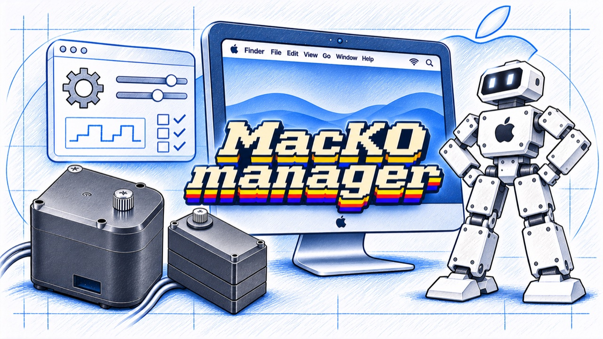

# MacKO Manager



[日本語](README.md) &nbsp;|&nbsp; **English**

> ⚠️ **Alpha release** — Limited field-tested alpha. Use at your own risk — servo damage is possible.

A Mac / Linux Chrome-based configuration tool for Kondo Kagaku KRS servos. Provides functionality equivalent to the official Windows-only `ICS 3.5/3.6 Manager` via WebUSB.

## Features

- **No driver install required** — direct WebUSB access to the `ICS USB Adapter HS`
- **macOS (Apple Silicon / Intel) + Ubuntu / Debian / Fedora / Arch** support
- Position command (continuous / center / free)
- Stretch / speed / current / temperature READ/WRITE
- ID read / write
- EEPROM 64-byte read / write (named parameter editing + flag bit breakdown)
- Baud rate auto-detect (1.25M / 625k / 115.2k × ID 0-31 scan)
- Per-model factory reset (bring-your-own `.sdt` presets)
- `.sdt` load / save (compatible with official Manager)
- Japanese / English UI toggle

## Requirements

- **Browser**: Chrome 89+ / Edge 89+ / Chromium 89+ / Brave (Safari / Firefox do NOT support WebUSB)
- **Hardware**: Kondo ICS USB Adapter HS (VID 0x165c / PID 0x0006) + any KRS-series servo

## Install

```sh
git clone https://github.com/Ninagawa123/MacKO_manager.git
cd MacKO_manager
```

## Launch

**macOS**:
Double-click `launch.command` (first time: right-click → Open).
If macOS says it "could not be executed because you do not have appropriate access privileges", run once in Terminal:
```sh
cd ~/Downloads/MacKO_manager-main   # the extracted folder
chmod +x launch.command launch.sh linux/*.sh
xattr -dr com.apple.quarantine .
```

**Linux**:
```sh
./linux/install-udev.sh   # first time only, installs udev rule
./launch.sh
```

## Usage

1. Plug in the ICS USB Adapter HS, connect a servo, and power it on
2. Click **Connect** → pick `ICS USB ADAPTER HS` in Chrome's dialog
3. Click **Auto** to auto-detect baud rate and ID
4. Edit positions / parameters / EEPROM as needed

## Factory Reset

Drop per-model `.sdt` files into `presets/` to enable one-click factory restore from the UI. See [presets/README.md](presets/README.md) for details.

## Disclaimer

This is **alpha-quality software**. Incorrect EEPROM writes can brick servo communication. Notably, **unchecking the "Serial only" flag bit switches the servo to PWM mode and silences ICS responses**. Recovery requires power-cycling the servo with correct timing.

The author assumes no liability for any damage arising from the use of this software. **Use at your own risk.**

## License

[MIT License](LICENSE) © 2026 Ninagawa Izumi

This is an independent open-source project and is **not** affiliated with or endorsed by Kondo Kagaku Co., Ltd.
